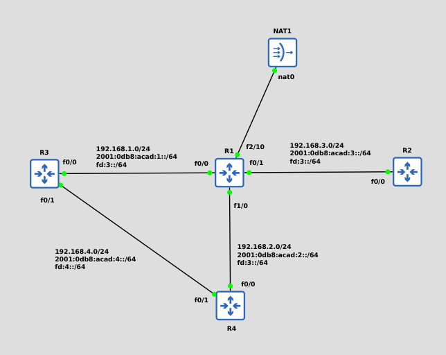

# Route statique IPv4

Le routage statique est une méthode fondamentale et incontournable de l’administration réseau, il consiste à insérer manuellement des chemins dans la table de routage d’un routeur ou d’un switch de niveau 3, pour définir explicitement l’acheminement des paquets IP

Une route statique peut être de différent type :

- Default
- Network
- Floating

Cisco IOS sélectionne généralement la route correspondant au préfixe le plus spécifique (longest prefix match)

## Topologie

|Routeur|IPv4|
|:-:|:-:|
|R1|192.168.1.1|
|R1|192.168.2.1|
|R1|192.168.3.1|
|R1|10.0.0.100|
|R2|192.168.3.2|
|R3|192.168.1.2|
|R3|192.168.4.2|
|R4|192.168.2.2|
|R4|192.168.4.1|



## Default route

Une route par défaut ( notée 0.0.0.0/0) est utilisée lorsque aucune route plus spécifique ne correspond à la destination du paquet. Elle est souvent appelée "gateway of last resort" (passerelle de dernier recours)

La route par défaut envoie les paquets vers une passerelle (généralement un FAI ou un routeur amont) qui, elle, sait les router, dans le cas ou aucune route ne peut acheminé le paquet et en l'absence d'une default gateway, le paquet sera drop

```bash
R4(config)#ip route 0.0.0.0 0.0.0.0 192.168.2.1
```

## Network route

Une Network Route, est une route statique configuré pour atteindre un réseau distant normalement non accessible avec la table de routage de base si le routeur ne dispose pas d'un prochain saut accessible

La configuration de la route doit se faire sur chaque routeur pour pouvoir, dans un premier temps émettre, mais aussi recevoir la réponse

```bash
R3(config)#ip route 192.168.2.0 255.255.255.0 192.168.1.1
R3(config)#ip route 192.168.3.0 255.255.255.0 192.168.1.1
```

## Floating

Une route flottante est une route de secours avec une distance administrative plus élevée que la route principale. Elle est utilisée pour assurer la redondance en cas de panne du lien principal

Une distance administrative doit être saisie manuellement à la fin de la route flottante. Il peut être intéressant de mettre une route statique avec une distance administrative élevé, dans le cas ou un protocole de routage dynamique crée une route similaire, la route statique flottante peut prendre le relais en cas de panne du processus

L'ajout d'une valeur après la déclaration d'une route permet, de déclarer la route flottante en spécifiant une valeur administrative

```bash
R4(config)#ip route 192.168.1.0 255.255.255.0 192.168.4.2
R4(config)#ip route 192.168.1.0 255.255.255.0 192.168.2.1 100
R4(config)#ip route 192.168.3.0 255.255.255.0 192.168.2.1
R4(config)#ip route 192.168.3.0 255.255.255.0 192.168.4.2 100
```
