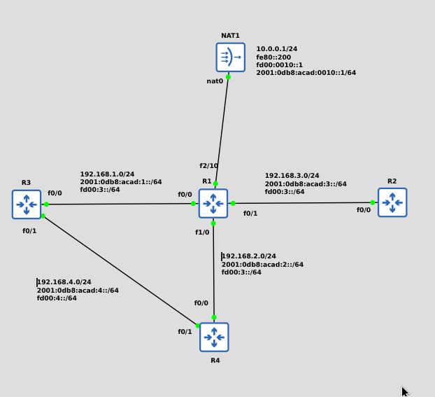

# Cisco - Routage statique IPv4

## Topologie

|Routeur|IPv4|
|:-:|:-:|
|R1|192.168.1.1 - 192.168.2.1 - 192.168.3.1 - 10.0.0.100|
|R2|192.168.3.2|
|R3|192.168.1.2 - 192.168.4.2|
|R4|192.168.2.2 - 192.168.4.1|



***

## Configuration complète

R1

```bash
ip route 192.168.4.0 255.255.255.0 192.168.1.2
ip route 192.168.4.0 255.255.255.0 192.168.2.2 100
ip route 0.0.0.0 0.0.0.0 fastethernet 2/10
```

R2

```bash
ip route 192.168.1.0 255.255.255.0 192.168.3.1
ip route 192.168.2.0 255.255.255.0 192.168.3.1
ip route 192.168.4.0 255.255.255.0 192.168.3.1
ip route 0.0.0.0 0.0.0.0 192.168.3.1
```

R3

```bash
ip route 192.168.3.0 255.255.255.0 192.168.1.1
ip route 192.168.3.0 255.255.255.0 192.168.4.1 100
ip route 192.168.2.0 255.255.255.0 192.168.1.1
ip route 192.168.2.0 255.255.255.0 192.168.4.1 100
ip route 0.0.0.0 0.0.0.0 192.168.1.1
ip route 0.0.0.0 0.0.0.0 192.168.4.1 100
```

R4

```bash
ip route 192.168.1.0 255.255.255.0 192.168.4.2
ip route 192.168.1.0 255.255.255.0 192.168.2.1 100
ip route 192.168.3.0 255.255.255.0 192.168.2.1
ip route 192.168.3.0 255.255.255.0 192.168.4.2 100
ip route 0.0.0.0 0.0.0.0 192.168.2.1
ip route 0.0.0.0 0.0.0.0 192.168.4.2 100
```
***

## Visualiser table routage

Quelques commandes utile pour visualiser le routage statique

show ip route : affiche l'ensemble de la table de routage

```bash
R1#sh ip route 
Codes: C - connected, S - static, R - RIP, M - mobile, B - BGP
       D - EIGRP, EX - EIGRP external, O - OSPF, IA - OSPF inter area 
       N1 - OSPF NSSA external type 1, N2 - OSPF NSSA external type 2
       E1 - OSPF external type 1, E2 - OSPF external type 2
       i - IS-IS, su - IS-IS summary, L1 - IS-IS level-1, L2 - IS-IS level-2
       ia - IS-IS inter area, * - candidate default, U - per-user static route
       o - ODR, P - periodic downloaded static route

Gateway of last resort is 10.0.0.1 to network 0.0.0.0

S    192.168.4.0/24 [1/0] via 192.168.2.2
                    [1/0] via 192.168.1.2
     10.0.0.0/16 is subnetted, 1 subnets
C       10.0.0.0 is directly connected, FastEthernet2/10
C    192.168.1.0/24 is directly connected, FastEthernet0/0
C    192.168.2.0/24 is directly connected, FastEthernet1/0
C    192.168.3.0/24 is directly connected, FastEthernet0/1
S*   0.0.0.0/0 [1/0] via 10.0.0.1
```

show ip route static : affiche seulement les entrées statique

```bash
R3#sh ip route static 
S    192.68.2.0/24 [1/0] via 192.168.1.1
S    192.168.2.0/24 [100/0] via 192.168.4.1
S    192.168.3.0/24 [1/0] via 192.168.1.1
S*   0.0.0.0/0 [1/0] via 192.168.1.1
```

show ip route 192.168.2.1 : affiche le chemin emprunté pour atteindre la destination

```bash
R3#sh ip route 192.168.3.2
Routing entry for 192.168.3.0/24
  Known via "static", distance 1, metric 0
  Routing Descriptor Blocks:
  * 192.168.1.1
      Route metric is 0, traffic share count is 1
```

## Test connection

ping

```bash
R3#ping 192.168.3.2

Type escape sequence to abort.
Sending 5, 100-byte ICMP Echos to 192.168.3.2, timeout is 2 seconds:
!!!!!
Success rate is 100 percent (5/5), round-trip min/avg/max = 60/64/76 ms
```

traceroute

```bash
R3#traceroute 192.168.3.2

Type escape sequence to abort.
Tracing the route to 192.168.3.2

  1 192.168.1.1 40 msec 36 msec 32 msec
  2 192.168.3.2 92 msec 64 msec 60 msec
```

Test route flottante, R3 f0/0 down

```bash
R3#traceroute 192.168.3.2

Type escape sequence to abort.
Tracing the route to 192.168.3.2

  1 192.168.4.1 60 msec 40 msec 32 msec
  2 192.168.2.1 96 msec 60 msec 60 msec
  3 192.168.3.2 120 msec 88 msec 120 msec
```