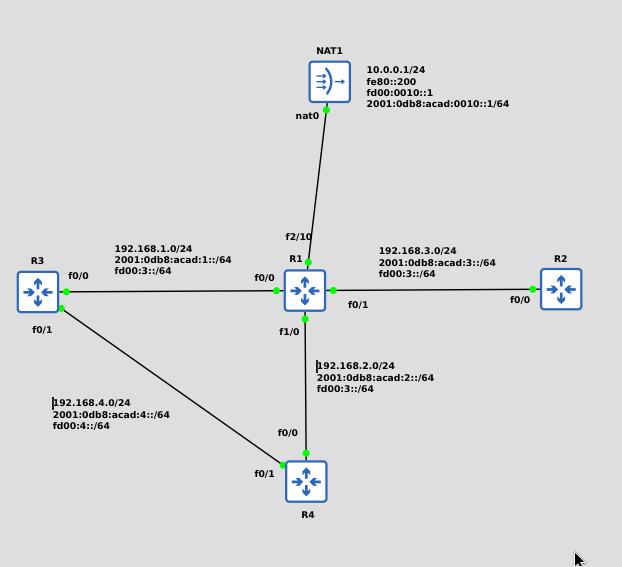

# Cisco - Routage statique IPv6

## Topologie

|Routeur|Interface|Link-local|Unique local|Global unicast|
|:-:|:-:|:-:|:-:|:-:|
|R1|f0/0|fe80::1|fd00:0001::1|2001:0db8:acad:0001::1|
|R1|f1/0|fe80::2|fd00:0002::1|2001:0db8:acad:0002::2|
|R1|f0/1|fe80::3|fd00:0003::1|2001:0db8:acad:0003::1|
|R1|f2/10|fe80::4|fd00:0010::1|2001:0db8:acad:0010::1|
|R2|f0/0|fe80::100|fd00:0003::2|2001:0db8:acad:0003::2|
|R3|f0/0|fe80::100|fd00:0001::2|2001:0db8:acad:0001::2|
|R3|f0/1|fe80::1|fd00:0004::2|2001:0db8:acad:0004::2|
|R4|f0/0|fe80::100|fd00:0002::2|2001:0db8:acad:0002::2|
|R4|f0/1|fe80::2|fd00:0004::1|2001:0db8:acad:004::1|



***

## Configuration complète

**R1**

```bash
ipv6 route 2001:0db8:acad:0001::/64 f1/0 fe80::100
ipv6 route 2001:0db8:acad:0001::/64 f0/0 fe80::100 130
ipv6 route ::/0 f2/10 fe80::200
```

**R2**

```bash
ipv6 route 2001:0db8:acad:0001::/64 f0/0 fe80::3
ipv6 route 2001:0db8:acad:0002::/64 f0/0 fe80::3
ipv6 route 2001:0db8:acad:0004::/64 f0/0 fe80::3
ipv6 route ::/0 f0/0 fe80::3
```

**R3**

```bash
ipv6 route 2001:0db8:acad:0003::/64 f0/0 fe80::1
ipv6 route 2001:0db8:acad:0003::/64 f0/1 fe80::2 130
ipv6 route 2001:0db8:acad:0002::/64 f0/1 fe80::2
ipv6 route 2001:0db8:acad:0002::/64 f0/0 fe80::1 130
ipv6 route ::/0 f0/0 fe80::1
ipv6 route ::/0 f0/1 fe80::2 130
```

**R4**

```bash
ipv6 route 2001:0db8:acad:0001::/64 f0/1 fe80::1
ipv6 route 2001:0db8:acad:0001::/64 f0/0 fe80::2 130
ipv6 route 2001:0db8:acad:0003::/64 f0/0 fe80::2
ipv6 route 2001:0db8:acad:0003::/64 f0/1 fe80::1 130
ipv6 route ::/0 f0/0 fe80::2
ipv6 route ::/0 f0/1 fe80::1 130
```
***

## Visualisation de la table de routage

Quelques commandes utile pour visualiser le routage statique

show ip route : affiche la route retenue pour atteindre une destination donnée

La table de routage est cependant, beaucoup moins digeste à lire que celle en IPv4

```bash
R1#sh ipv6 route
IPv6 Routing Table - 20 entries
Codes: C - Connected, L - Local, S - Static, R - RIP, B - BGP
       U - Per-user Static route
       I1 - ISIS L1, I2 - ISIS L2, IA - ISIS interarea, IS - ISIS summary
       O - OSPF intra, OI - OSPF inter, OE1 - OSPF ext 1, OE2 - OSPF ext 2
       ON1 - OSPF NSSA ext 1, ON2 - OSPF NSSA ext 2
S   ::/0 [1/0]
     via FE80::200, FastEthernet2/10
C   FD:1::/64 [0/0]
     via ::, FastEthernet0/0
L   FD:1::1/128 [0/0]
     via ::, FastEthernet0/0
C   FD:2::/64 [0/0]
     via ::, FastEthernet1/0
L   FD:2::1/128 [0/0]
     via ::, FastEthernet1/0
C   FD:3::/64 [0/0]
     via ::, FastEthernet0/1
L   FD:3::1/128 [0/0]
     via ::, FastEthernet0/1
C   FD:10::/64 [0/0]
     via ::, FastEthernet2/10
L   FD:10::1/128 [0/0]
     via ::, FastEthernet2/10
C   2001:DB8:ACAD:1::/64 [0/0]
     via ::, FastEthernet0/0
L   2001:DB8:ACAD:1::1/128 [0/0]
     via ::, FastEthernet0/0
C   2001:DB8:ACAD:2::/64 [0/0]
     via ::, FastEthernet1/0
L   2001:DB8:ACAD:2::1/128 [0/0]
     via ::, FastEthernet1/0
C   2001:DB8:ACAD:3::/64 [0/0]
     via ::, FastEthernet0/1
L   2001:DB8:ACAD:3::1/128 [0/0]
     via ::, FastEthernet0/1
S   2001:DB8:ACAD:4::/64 [1/0]
     via FE80::100, FastEthernet1/0
C   2001:DB8:ACAD:10::/64 [0/0]
     via ::, FastEthernet2/10
L   2001:DB8:ACAD:10::1/128 [0/0]
     via ::, FastEthernet2/10
L   FE80::/10 [0/0]
     via ::, Null0
L   FF00::/8 [0/0]
     via ::, Null0
```

show ip route static : affiche seulement les entrées statique

```bash
R3#sh ipv6 route static 
IPv6 Routing Table - 13 entries
Codes: C - Connected, L - Local, S - Static, R - RIP, B - BGP
       U - Per-user Static route
       I1 - ISIS L1, I2 - ISIS L2, IA - ISIS interarea, IS - ISIS summary
       O - OSPF intra, OI - OSPF inter, OE1 - OSPF ext 1, OE2 - OSPF ext 2
       ON1 - OSPF NSSA ext 1, ON2 - OSPF NSSA ext 2
S   ::/0 [1/0]
     via FE80::1, FastEthernet0/0
S   2001:DB8:ACAD:2::/64 [1/0]
     via FE80::2, FastEthernet0/1
S   2001:DB8:ACAD:3::/64 [1/0]
     via FE80::1, FastEthernet0/0
```

show ip route `2001:0db8:acad:0001::2` : affiche le chemin emprunté pour atteindre la destination cible

```bash
R3#show ipv6 route 2001:0db8:acad:0001::2
IPv6 Routing Table - 13 entries
Codes: C - Connected, L - Local, S - Static, R - RIP, B - BGP
       U - Per-user Static route
       I1 - ISIS L1, I2 - ISIS L2, IA - ISIS interarea, IS - ISIS summary
       O - OSPF intra, OI - OSPF inter, OE1 - OSPF ext 1, OE2 - OSPF ext 2
       ON1 - OSPF NSSA ext 1, ON2 - OSPF NSSA ext 2
L   2001:DB8:ACAD:1::2/128 [0/0]
     via ::, FastEthernet0/0
```

## Test connectivité

Contrôle avec ping pour tester la connection

```bash
R3#ping ipv6 2001:0db8:acad:0003::2      

Type escape sequence to abort.
Sending 5, 100-byte ICMP Echos to 2001:DB8:ACAD:3::2, timeout is 2 seconds:
!!!!!
Success rate is 100 percent (5/5), round-trip min/avg/max = 24/27/28 ms
```

Vérification du chemin emprunté avec traceroute

```bash
R3#traceroute ipv6 2001:0db8:acad:0003::2

Type escape sequence to abort.
Tracing the route to 2001:DB8:ACAD:3::2

  1 2001:DB8:ACAD:1::1 28 msec 28 msec 24 msec
  2 2001:DB8:ACAD:3::2 56 msec 28 msec 28 msec

```

Test route flottante avec traceroute, le lien FastEthernet0/0 du routeur R3 est mis en down

```bash
R3#traceroute ipv6 2001:0db8:acad:0003::2

Type escape sequence to abort.
Tracing the route to 2001:DB8:ACAD:3::2

  1 2001:DB8:ACAD:4::1 28 msec 24 msec 28 msec
  2 2001:DB8:ACAD:2::1 80 msec 52 msec 40 msec
  3 2001:DB8:ACAD:3::2 56 msec 40 msec 40 msec
```
