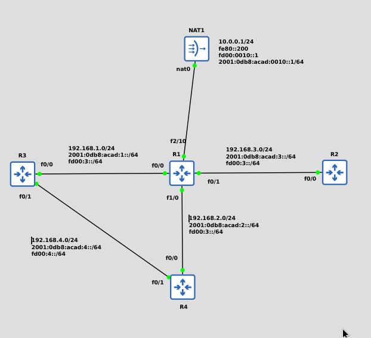

# Route statique IPv6

Le routage statique est une méthode fondamentale de l'administration réseau. Il consiste à ajouter manuellement des routes dans la table de routage d'un routeur ou d'un commutateur de niveau 3 afin de définir explicitement l'acheminement des paquets IPv6

Une route statique peut être de différents type :

- Default
- Network
- Floating

Pour que le routage IPv6 soit fonctionnel, il est nécessaire d'activer le routage IPv6

Cisco :

```bash
Router(config)# ipv6 unicast-routing
```

Avec IPv6, le routage doit se faire avec les adresses Global Unicast Address, mais aussi avec les Uniq Local Address si elles sont utilisées

Note : Exemple avec commande Cisco IOS

## Topologie

|Routeur|Interface|Link-local|Unique local|Global unicast|
|:-:|:-:|:-:|:-:|:-:|
|R1|f0/0|fe80::1|fd00:0001::1|2001:0db8:acad:0001::1|
|R1|f1/0|fe80::2|fd00:0002::1|2001:0db8:acad:0002::2|
|R1|f0/1|fe80::3|fd00:0003::1|2001:0db8:acad:0003::1|
|R1|f2/10|fe80::4|fd00:0010::1|2001:0db8:acad:0010::1|
|R2|f0/0|fe80::100|fd00:0003::2|2001:0db8:acad:0003::2|
|R3|f0/0|fe80::100|fd00:0001::2|2001:0db8:acad:0001::2|
|R3|f0/1|fe80::1|fd00:0004::2|2001:0db8:acad:0004::2|
|R4|f0/0|fe80::100|fd00:0002::2|2001:0db8:acad:0002::2|
|R4|f0/1|fe80::2|fd00:0004::1|2001:0db8:acad:004::1|

***



***

## Default Route

Une route par défaut (notée ::/0) est utilisée lorsqu'aucune route plus spécifique ne correspond à la destination du paquet. Elle est souvent appelée « Gateway of Last Resort » (passerelle de dernier recours)

Elle permet notamment de transmettre les paquets vers un routeur amont, généralement utilisé comme passerelle vers Internet

une route par défaut IPv4 vers `0.0.0.0` s’écrit en ipv6 `ipv6 route ::/0 <interface> <link-local_voisin>`

```bash
R1(config)#ipv6 route ::/0 f2/10 fe80::200
```

## Network Route

Une Network Route, est une route statique configuré pour atteindre un réseau distant normalement non accessible avec la table de routage de base.

Pour assurer une communication bidirectionnelle entre deux réseaux, il est nécessaire que les routeurs concernés disposent d'une route permettant d'atteindre le réseau distant et d'un chemin de retour

Pour configurer une Network route, il existe plusieurs façon de l'écrire

- interface de sortie
- interface de sortie + link-local du voisin : 
- adresse ipv6 du voisin

```bash
R2(config)#ipv6 route 2001:0db8:acad:0001::/64 fa0/0
R2(config)#ipv6 route 2001:0db8:acad:0001::/64 fa0/0 fe80::3
R2(config)#ipv6 route 2001:0db8:acad:0001::/64 2001:db8:acad:3::1
```

**Interface seule** : 

le chemin est déterminé par l'interface, utile dans une liaison point-to-point

Attention : sur un réseau Ethernet classique, cette syntaxe est généralement déconseillée. Le routeur peut tenter de résoudre l'adresse MAC de chaque destination IPv6 individuellement via Neighbor Discovery

**Interface + link-local** :

le chemin et le voisin sont explicitement identifiés.

une adresse link-local n'est valable que sur le lien local mais plusieurs interfaces peuvent avoir un voisin utilisant exactement la même adresse fe80::2, l'interface permet donc de lever toute ambiguïté.

**IPv6 globale** : 

le prochain saut est déterminé par une recherche récursive dans la table de routage.

fonctionne notamment lorsque :

- Le prochain saut est joignable via une route directement connectée.
- Le prochain saut est joignable via une autre route présente dans la table de routage.

il faut cependant, que le routeur sache déja comment atteindre cette adresse IPv6

## Floating Route

Une route flottante est une route de secours avec une distance administrative plus élevée que la route principale. Elle est utilisée pour assurer la redondance en cas de panne du lien principal

Une distance administrative supérieure à celle de la route principale doit être définie afin que la route statique ne soit utilisée qu'en solution de secours

Il peut être intéressant de configurer une route statique avec une distance administrative élevée lorsqu'un protocole de routage dynamique fournit déjà une route vers le même réseau, la route statique pourra alors prendre le relais si la route dynamique disparaît

```bash
R2(config)#ipv6 route 2001:0db8:acad:0001::/64 fa0/0 fe80::3 130
```
