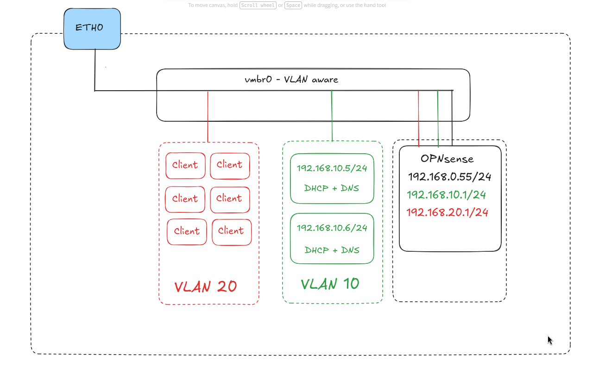

# DHCP & DNS en haute disponibilite

## Contexte

Dans le cadre de ce projet, j'ai mis en place une infrastructure réseau sous Linux associant un service DHCP à un service DNS dynamique (DDNS).

L'objectif est d'automatiser l'attribution des adresses IP aux clients et de maintenir à jour les enregistrements DNS correspondants, le tout en sécurisant les échange entre les DHCP et les DNS.

## Problematique

Comment automatiser l'attribution des adresses IP et la mise à jour des enregistrements DNS afin de simplifier l'administration d'un réseau ?

Comment faire en sorte, de sécuriser l'échange pour s'assurer qu'un serveur DNS non autorisé ne puisse pas se synchroniser avec les DNS existant ?

Si un des serveurs DHCP ou DNS tombe en panne, comment rendre l'infrastructure résiliante ?

## Objectif

- Automatiser l'attribution des adresses IP via DHCP.

- Configurer un service DNS pour la résolution des noms de machines.
- Mettre en place les mises à jour DNS dynamiques.
- Vérifier la cohérence entre les adresses IP attribuées et les enregistrements DNS.
- Valider le fonctionnement de l'infrastructure à l'aide de tests.
- Reduction des SPOF
- Utilisation de clé TSIG pour sécuriser l'échange entre les DHCP et les DNS, mais aussi pour la réplication entre DNS

## Architecture et Environnement

- Hyperviseur : Proxmox

- Système d'exploitation : OPNsense, Debian
- Service DHCP : kea-dhcp
- Service DNS : Bind9
- Réseau :
    - LAN local : 192.168.0.0/24
    - LAN 10    : 192.168.10.0/24
    - LAN 20    : 192.168.20.0/24



## Installation et configuration

Les paquets requis pour la configuration des DHCP et DNS:

- kea-dhcp4-server

- kea-dhcp-ddns-server
- kea-ctrl-agent
- bind9

***

### OPNsense

Un des premier éléments à mettre en place, est le DHCP relay, pour permettre à mon LAN clients de communiquer avec le LAN où, les serveurs DHCP se situe et permettre de transmettre les messages DHCP


***

### DHCP

Kea-dhcp enregistre touts les leases dans un fichier créer lors de l'installation, qui se situe dans : `/var/lib/kea/kea-leases4.csv` et est mis à jour automatiquement

Les fichiers de configurations du serveur DHCP principale peuvent être copié sur l'autre serveur, pour être sûr d'avoir une configuration identique

Note : La configuration du DHCP se fait en `JSON`

#### Configuration DHCP

Le fichier `/etc/kea/kea-dhcp4.conf` étant déja existant lors de l'installation, il est recommandé de faire un copie du fichier de base.

La configuration du  bloc DHCP se compose de plusieurs sections:

- Timers

- Interface
- Gestion leases
- Gestion Sous-réseaux, pools & options DHCP

***

Explications sur la configuration de chaque bloc

1) Timers ( en secondes )

La définissions des timers, va permettre de donner les directives de, quand demander une mise à jour du lease, sa durée de vie et dans le cas échéant, supprimer le lease obsolète du fichier de leases

- "valid-lifetime": 2000 : Durée validité du leases
- "renew-timer": 500      : Timer T1, délais avant l'émission d'un message DHCP REQUEST afin de conserver le lease 
- "rebind-timer": 1000    : Timer T2, similaire à renew-timer mais se produit dans le cas ou, le serveur DHCP ne répond pas à la requête du "renew-timer"

***

2) Interface

Spécifie l'interface d'écoute pour la réception de trame DHCP, plusieurs interfaces peuvent être spécifié

- "interfaces": [ "ens18" ] : Désigne l'interface d'écoute pour la réception de message DHCP

***

3) Gestion leases

Configure le comportement de kea-dhcp4, sur comment les leases doivent être stockés, ou, comment gérer la supppression de lease obsolète et le nombre d'erreurs autoriser avant que le fichier, ne soit plus lu

- "type": "memfile" : Désigne comment enregistrer les leases, "memfile" est le fichier `/var/lib/kea/kea-leases4.csv`

- "persist": true : Dans le cas d'un redémarrage, les leases restent enregistrer dans le fichiers
- "name": "/var/lib/kea/kea-leases4.csv" : Chemin du fichiers de lease
- "lfc-interval": 800 : Délai avant que le fichier contenant les leases soit nettoyer de tout les enregistrements anciens
- "max-row-errors": 100 : définit le nombre maximal de lignes corrompues ou erronées que Kea tolérera lors de la lecture d'un fichier de bail avant d'interrompre le chargement et de se fermer

***

4) Gestion sous-réseaux

Définission des réseaux, dont l'attribution des IP,option DHCP et pools, est géré par kea-dhcp

- "id": 1 : ID du réseau à déclarer, à incrémenter pour chaque nouveau réseau

- "subnet": "192.168.10.0/24" : Définir le réseau au format CIDR
- "pools": : Déclaration du/des pools réseau, plusieurs pools peuvent être déclaré tant que, non chevauchant
- "pool": "192.168.10.20 - 192.168.10.30"
- "option-data": Définition des options DHCP, met à jour pour les clients le fichier `/etc/resolv.conf`
- "name": "<name>" : Indiquer, soit le code de l'option, soit le nom de l'option
- "data": "<data>" : Indique la valeur correspondant à l'option 

```json
{
    "Dhcp4":
    {
        "valide-lifetime": 2000,
        "renew-timer": 500,
        "rebind-timer": 1000,
        "interfaces-config":
        {
            "interfaces": [ "ens18" ]
        },
        "lease-database":
        {
            "type": "memfile",
            "persist": true,
            "name": "/var/lib/kea/kea-leases4.csv",
            "lfc-interval": 800,
            "max-row-errors": 100
        },
        "subnet4":
        [
            {
                "id": 1,
                "subnet": "192.168.10.0/24",
                "pools":
                [
                    {
                        "pool": "192.168.10.20 - 192.168.10.30"
                    }
                ],
                "option-data":
                [
                    {
                        "name": "domain-name-servers",
                        "data": "192.168.10.5,192.168.10.6"
                    },
                    {
                        "name": "domain-name",
                        "data": "lab.lan"
                    },
                    {
                        "name": "domain-search",
                        "data": "lab.lan"
                    },
                    {
                        "name": "routers",
                        "data": "192.168.10.1"
                    }
                ]
            },
            {
                "id": 2,
                "subnet": "192.168.20.0/24",
                "pools":
                [
                    {
                        "pool": "192.168.20.10 - 192.168.20.40"
                    }
                ],
                "option-data":
                [
                    {
                        "name": "domain-name-servers",
                        "data": "192.168.10.5,192.168.10.6"
                    },
                    {
                        "name": "domain-name",
                        "data": "lab.lan"
                    },
                    {
                        "name": "domain-search";
                        "data": "lab.lan"
                    },
                    {
                        "name": "routers",
                        "data": "192.168.20.1"
                    }
                ],
                
            }
        ]
    }
}
```

#### Configuration DHCP-DDNS

La configuration du DHCP-DDNS se fait à travers 2 fichiers

- kea-dhcp4.conf

- kea-dhcp-ddns.conf

**kea-dhcp4.conf**

Dans le fichier `kea-dhcp4.conf`, la configuration du DDNS va permettre d'indiquer, à kea-dhcp, comment interagir entre le DHCP et le service kea-ddns, mais aussi comment le NCR ( Name Change Request ) doit compléter le fonctionnement du ddns

- "enable-updates": true : Active globalement l'envoi des requêtes de mise à jour DNS par le serveur DHCP

- "server-ip": "127.0.0.1" : adresse IP sur laquelle le démon DDNS écoute
- "server-port": 53001 : Port réseau utilisé par Kea DDNS pour recevoir les demandes du serveur DHCP
- "sender-port": 0 : Port source utilisé par le serveur DHCP pour envoyer ses messages. 0 indique à Kea de laisser le système d'exploitation choisir un port éphémère libre de manière dynamique
- "ncr-protocol": "UDP" : Protocole réseau utilisé pour le transport des requêtes NCR
- "ncr-format": "JSON" : Format des données encapsulées dans les requêtes de mise à jour
- "ddns-send-updates": true : Confirme l'envoi des requêtes
- "ddns-override-client-update": true : Ignore la configuration ou la préférence du client
- "ddns-override-no-update": true :  : Si un client demande explicitement à ne pas publier son nom dans le DNS, le serveur ignore sa demande
- "ddns-qualifying-prefix": "lab.lan" : Nom de domaine ajouté automatiquement, à la fin du nom d'hôte
- "ddns-generated-prefix": "dhcp" : Préfixe pour générer un nom générique si le client ne fournis pas de non d'hôte valide ( souvent : dhcp-192.168.20.10 )
- "ddns-replace-client-name": "when-not-present" : Si le nom du client n'est pas fournis lors de la requête, kea-dhcp en génère un à partir du prefix + de l'IP attribué

```json
...
    "dhcp-ddns":
    {
        "enable-updates": true,
        "server-ip": "127.0.0.1",
        "server-port": 53001,
        "sender-port": 0,
        "ncr-protocol": "UDP",
        "ncr-format": "JSON"
        },
        "ddns-send-updates": true,
        "ddns-override-client-update": true,
        "ddns-override-no-update": true,
        "ddns-qualifying-prefix": "lab.lan",
        "ddns-generated-prefix": "dhcp",
        "ddns-replace-client-name": "when-not-present",
...
```

Le fichier `kea-ddns.conf` va permettre, de spécifier comment le service DHCP-DDNS va communiquer avec le serveur DNS pour pouvoir, ajouter/modifier des enregistrements

Le bloc "tsig-keys" permet de renseigner une clé TSIG, qui sera ajouté sur les serveurs DNS pour autoriser les ajouts DNS provenant de ce DHCP, via l'authentification par la clé TSIG

La section forward-ddns va permettre de spécifier, vers quel serveur pousser les modifications DNS, mais surtout en spécifiant la zone cible. 

La déclaration des zones, qu'elles soient directe comme inverse se fait de la même manière

Dans ce bloc, l'utilisation de la clé TSIG va permettre de signer les requêtes DNS provenant du DDNS en direction du DNS

```json
{
    "DhcpDdns":
    {
        "tsig-keys":
        [
            {
                "name": "ma-cle-ddns.key",
                "algorithm": "hmac-sha256",
                "secret": "HGj/s1alczSQMz8GAmVG/nwIsd0JiDxTX2whyXpk+MA="
            }
        ],
        "forward-ddns":
        {
            "ddns-domains":
            [
                {
                    "name": "lab.lan.",
                    "key-name": "ma-cle-ddns.key",
                    "dns-servers":
                    [
                        {
                            "ip-address": "192.168.10.5",
                            "port": 53
                        },
                        {
                            "ip-address": "192.168.10.6",
                            "port": 53
                        }
                    ]
                }
            ]
        },
        "reverse-ddns":
        {
            "ddns-domains":
            [
                {
                    "name": "10.168.192.in-addr.arpa.",
                    "key-name": "ma-cle-ddns.key",
                    "dns-servers":
                    [
                        {
                            "ip-address": "192.168.10.5",
                            "port": 53
                        },
                        {
                            "ip-address": "192.168.10.6",
                            "port": 53
                        }
                    ]
                },
                {
                    "name": "20.168.192.in-addr.arpa.",
                    "key-name": "ma-cle-ddns.key",
                    "dns-servers":
                    [
                        {
                            "ip-address": "192.168.10.5",
                            "port": 53
                        },
                        {
                            "ip-address": "192.168.10.6",
                            "port": 53
                        }
                    ]
                }
            ]
        }
    }
}
```

#### Configuration reservation

Le bloc réservation, va permettre de créer les réserrvations pour des clients DHCP et est assez simple à gérer

- "hw-address": "bv:24:11:37:b5:a2" : Spécifie l'adresse MAC de l'interface du client
- "ip-address": "192.168.20.10", : Désigne une adresse IP réservé pour le client avec l'adresse MAC correspondante
- "user-context": { "comment": "proxmox manager" } : User-context va servire, en commentaire pour simplifier la lecture des réservations

```json
...
"reservations":
                [
                    {
                        "hw-address": "bv:24:11:37:b5:a2",
                        "ip-address": "192.168.20.10",
                        "user-context": { "comment": "proxmox manager" }
                    },
                    {
                        "hw-address": "bc:24:11:1d:19:bd",
                        "ip-address": "192.168.20.11",
                        "user-context": { "comment": "px-pve-1" }
                    },                    {
                        "hw-address": "bc:24:11:95:4a:06",
                        "ip-address": "192.168.20.12",
                        "user-context": { "comment": "px-pve-2" }
                    },                    {
                        "hw-address": "nv:24:11:d1:32:8d",
                        "ip-address": "192.168.20.13",
                        "user-context": { "comment": "px-pve-3" }
                    },                    {
                        "hw-address": "bc:24:11:f4:a2:27",
                        "ip-address": "192.168.20.14",
                        "user-context": { "comment": "proxmox-backup" }
                    },                    {
                        "hw-address": "bc:24:11:34:bf:f6",
                        "ip-address": "192.168.20.15",
                        "user-context": { "comment": "proxmox-mail" }
                    }
                ]
...
```

#### Configuration Load-balance

La configuration du load-balance passe par des "hooks", qui peuvent fonctionner de 2 façon différents

- fail-over
- load-balance

Dans le bloc " high-availability ", il faut spécifié, le mode de fonctionnement, les timers du heartbeat et les pairs

- "this-server-name": "dhcp-ddns-1" : Décrit le nom du serveur actuel, si le fichier est copié, modifier le nom pour les autres serveurs

- "mode": "load-balancing" : Défini le mode de high availability
- "heartbeat-delay": 10000 : Définit le timer du heartbeat en `ms`
- "max-response-delay": 60000 : Délai imparti avant de considéré un pair, comme étant down
- "peers":
- "name": "dhcp-ddns-1" : Défini le nom du pair, même le serveur local
- "url": "http://192.168.10.5:8005/" : URL d'écoute de l'API de la haute disponibilité, le port doit être le même pour chaque pair sur chaque serveur
- "role": "primary" : Spécifie si le serveur est le primary ou secondary
- "auto-failover": true : Défini si le fail-over automatique doit être utilisé
- "user": "kea-api" : utilisateur défini dans `/etc/kea/kea-ctrl-agent`
- "password": "test" : mot de passe défini dans `/etc/kea/kea-api-password` et du chemin défini dans `/etc/kea/kea-ctrl-agent`

```json
"hooks-libraries":
        [
            {
                "library": "libdhcp_leases_cmds.so",
                "parameters": {}
            },
            {
                "library": "libdhcp_ha.so",
                "parameters": {
                    "high-availability": [
                        {
                            "this-server-name": "dhcp-ddns-1",
                            "mode": "load-balancing",
                            "heartbeat-delay": 10000,
                            "max-response-delay": 60000,
                            "peers":
                            [
                                {
                                    "name": "dhcp-ddns-1",
                                    "url": "http://192.168.10.5:8005/",
                                    "role": "primary",
                                    "auto-failover": true,
                                    "user": "kea-api",
                                    "password": "test"
                                },
                              {
                                    "name": "dhcp-ddns-2",
                                    "url": "http://192.168.10.6:8005/",
                                    "role": "secondary",
                                    "auto-failover": true,
                                    "user": "kea-api",
                                    "password": "test"
                                }
                            ]
                        }
                    ]
                }
            }
        ],
```

#### DHCP control agent

Kea-ctrl-agent est un paquet, qui va permettre de configurer l'API de kea-dhcp pour le fonctionnement en load-balancing

Dans le fichier `/etc/kea/kea-ctrl-agent.conf`, il y'a 2 bloc à modifier

- "control-agent"
- "authentication"

Contrôle agent va servir à configurer comment l'API doit communiquer avec la fonction de load-balancing et contrôler l'authentification des serveurs DHCP

"http-host": "0.0.0.0" : Indique l'IP à écouté
"http-port": 8000 : Indique le port utilisé ( 8000 par défaut )

```bash
{
...
"Control-agent": {
    "http-host": "0.0.0.0",
    "http-port": 8000,
    }
}
...
```

Ensuite, il faut configurer l'authentification

Dans le bloc client, il est attendu un fichier contenant le mot de passe et son chemin, que j'ai simplement appelé "kea-api-password"

```bash
...
"authentication":
{
    "type": "basic",
    "realm": "Kea Control Agent",
    "directory": "/etc/kea",
    "clients": [
        {
            "user": "kea-api",
            "password-file": "kea-api-password"
        }
    ]
},
...
```

Il faut bien penser à créer le fichier `/etc/kea/kea-api-password` dans `/etc/kea/` et écrire uniquement le mot de passe à l'intérieur

```bash
echo "test" > /etc/kea/kea-api-password
```

### DNS

#### Déclaration zone DNS

namd.conf.local

```bash
include "/etc/bind/key/ma-cle-tsig.key";
include "/etc/bind/key/ma-cle-ddns.key";

zone "lab.lan"
{
    type master;
    file "/var/cache/bind/db.lab.lan";
    allow-update { key "ma-cle-ddns.key"; };
    allow-transfer { key "ma-cle-tsig.key; };
    notify yes;
};

zone "10.168.192.in-addr.arpa"
{
    type master;
    file "/var/cache/bind/db-reverse10.lab.lan";
    allow-update { key "ma-cle-ddns.key"; };
    allow-transfer { key "ma-cle-tsig.key; };
    notify yes;
};

zone "lab.lan"
{
    type master;
    file "/var/cache/bind/db-reverse20.lab.lan";
    allow-update { key "ma-cle-ddns.key"; };
    allow-transfer { key "ma-cle-tsig.key; };
    notify yes;    
};
```

#### Création zone DNS

creation zone

```bash
zone directe
$ORIGIN lab.lan 
$TTL 86400 
                @   	IN  	SOA 	dns1.lab.lan.	admin.lab.lan. (
                                        2001062501 ; serial                     
                                        21600      ; refresh after 6 hours                     
                                        3600       ; retry after 1 hour                     
                                        604800     ; expire after 1 week                     
                                        86400 )    ; minimum TTL of 1 day  
                                NS      dhcp-ddns-1.lab.lan.
                                NS      dhcp-ddns-2.lab.lan.
dhcp-ddns-1.lab.lan.    A               192.168.10.5
dhcp-ddns-2.lab.lan.    A               192.168.10.6
```

zone reverse

LAN 10

```bash
$ORIGIN lab.lan 
$TTL 86400 
                @   	IN  	SOA 	dns1.lab.lan.	admin.lab.lan. (
                                        2001062501 ; serial                     
                                        21600      ; refresh after 6 hours                     
                                        3600       ; retry after 1 hour                     
                                        604800     ; expire after 1 week                     
                                        86400 )    ; minimum TTL of 1 day  
                                NS      dhcp-ddns-1.lab.lan.
                                NS      dhcp-ddns-2.lab.lan.
dhcp-ddns-1.lab.lan.    A               192.168.10.5
dhcp-ddns-2.lab.lan.    A               192.168.10.6
```

LAN 20

```bash
$ORIGIN lab.lan 
$TTL 86400 
                @   	IN  	SOA 	dns1.lab.lan.	admin.lab.lan. (
                                        2001062501 ; serial                     
                                        21600      ; refresh after 6 hours                     
                                        3600       ; retry after 1 hour                     
                                        604800     ; expire after 1 week                     
                                        86400 )    ; minimum TTL of 1 day  
                                NS      dhcp-ddns-1.lab.lan.
                                NS      dhcp-ddns-2.lab.lan.
dhcp-ddns-1.lab.lan.    A               192.168.10.5
dhcp-ddns-2.lab.lan.    A               192.168.10.6
```

#### Configuration DNS

named.conf.options

```bash
acl "lan"{
    192.168.10.0/24;
    192.168.20.0/24;
    localhost;
    localnets;
};
options {
    directory "/var/cache/bind";
    version "not available";
    forwarders {
        1.1.1.1;
        9.9.9.9;
    };
    recursion yes;
    dnssec-validation auto;
    listen-on { any; };
    allow-query { lan; };
};
```

## Test

serie de test

### DHCP

dhcp primary seul pour attribution ip

dhcp en ha pour replication fichier lease

dhcp 1 off pour voir si dhcp 2 attribue une ip

### DNS

dns 1 seul ajout dhcp client dans dns

dns 1 + 2 pour check axfr/ixfr

dns2 pour voir si dhcp ajoute bien dans secondary

dns1+2 pour voir si dns2 forward l'update vers le master

## Annexe

### DHCP

#### Kea-dhcp4

```json
{
    "Dhcp4":
    {
        "hooks-libraries":
        [
            {
                "library": "libdhcp_leases_cmds.so",
                "parameters": {}
            },
            {
                "library": "libdhcp_ha.so",
                "parameters": {
                    "high-availability": [
                        {
                            "this-server-name": "dhcp-ddns-1",
                            "mode": "load-balancing",
                            "heartbeat-delay": 10000,
                            "max-response-delay": 60000,
                            "peers":
                            [
                                {
                                    "name": "dhcp-ddns-1",
                                    "url": "http://192.168.10.5:8005/",
                                    "role": "primary",
                                    "auto-failover": true,
                                    "user": "kea-api",
                                    "password": "test"
                                },
                              {
                                    "name": "dhcp-ddns-2",
                                    "url": "http://192.168.10.6:8005/",
                                    "role": "secondary",
                                    "auto-failover": true,
                                    "user": "kea-api",
                                    "password": "test"
                                }
                            ]
                        }
                    ]
                }
            }
        ],
        "dhcp-ddns":
        {
            "enable-updates": true,
            "server-ip": "127.0.0.1",
            "server-port": 53001,
            "sender-port": 0,
            "ncr-protocole": "UDP",
            "ncr-format": "JSON"
        },
        "ddns-send-updates": true,
        "ddns-override-client-update": true,
        "ddns-override-no-update": true,
        "ddns-qualifying-prefix": "lab.lan",
        "ddns-generated-prefix": "dhcp",
        "ddns-replace-client-name": "when-not-present",
        "valide-lifetime": 2000,
        "renew-timer": 500,
        "rebind-timer": 1000,
        "interfaces-config":
        {
            "interfaces": [ "ens18" ]
        },
        "lease-database":
        {
            "type": "memfile",
            "persist": true,
            "name": "/var/lib/kea/kea-leases4.csv",
            "lfc-interval": 800,
            "max-row-errors": 100
        },
        "subnet4":
        [
            {
                "id": 1,
                "subnet": "192.168.10.0/24",
                "pools":
                [
                    {
                        "pool": "192.168.10.20 - 192.168.10.30"
                    }
                ],
                "option-data":
                [
                    {
                        "name": "domain-name-servers",
                        "data": "192.168.10.5,192.168.10.6"
                    },
                    {
                        "name": "domain-name",
                        "data": "lab.lan"
                    },
                    {
                        "name": "domain-search",
                        "data": "lab.lan"
                    },
                    {
                        "name": "routers",
                        "data": "192.168.10.1"
                    }
                ]
            },
            {
                "id": 2,
                "subnet": "192.168.20.0/24",
                "pools":
                [
                    {
                        "pool": "192.168.20.10 - 192.168.20.40"
                    }
                ],
                "option-data":
                [
                    {
                        "name": "domain-name-servers",
                        "data": "192.168.10.5,192.168.10.6"
                    },
                    {
                        "name": "domain-name",
                        "data": "lab.lan"
                    },
                    {
                        "name": "domain-search";
                        "data": "lab.lan"
                    },
                    {
                        "name": "routers",
                        "data": "192.168.20.1"
                    }
                ],
                "reservations":
                [
                    {
                        "hw-address": "bv:24:11:37:b5:a2",
                        "ip-address": "192.168.20.10",
                        "user-context": { "comment": "proxmox manager" }
                    },
                    {
                        "hw-address": "bc:24:11:1d:19:bd",
                        "ip-address": "192.168.20.11",
                        "user-context": { "comment": "px-pve-1" }
                    },                    {
                        "hw-address": "bc:24:11:95:4a:06",
                        "ip-address": "192.168.20.12",
                        "user-context": { "comment": "px-pve-2" }
                    },                    {
                        "hw-address": "nv:24:11:d1:32:8d",
                        "ip-address": "192.168.20.13",
                        "user-context": { "comment": "px-pve-3" }
                    },                    {
                        "hw-address": "bc:24:11:f4:a2:27",
                        "ip-address": "192.168.20.14",
                        "user-context": { "comment": "proxmox-backup" }
                    },                    {
                        "hw-address": "bc:24:11:34:bf:f6",
                        "ip-address": "192.168.20.15",
                        "user-context": { "comment": "proxmox-mail" }
                    }
                ]
            }
        ]
    }
}
```

#### Kea-dhcp-ddns

Fichier `/etc/kea-dhcp-ddns.conf`, a copier sur chaque serveur kea-dhcp

```json
{
    "DhcpDdns":
    {
        "tsig-keys":
        [
            {
                "name": "ma-cle-ddns.key",
                "algorithm": "hmac-sha256",
                "secret": "HGj/s1alczSQMz8GAmVG/nwIsd0JiDxTX2whyXpk+MA="
            }
        ],
        "forward-ddns":
        {
            "ddns-domains":
            [
                {
                    "name": "lab.lan.",
                    "key-name": "ma-cle-ddns.key",
                    "dns-servers":
                    [
                        {
                            "ip-address": "192.168.10.5",
                            "port": 53
                        },
                        {
                            "ip-address": "192.168.10.6",
                            "port": 53
                        }
                    ]
                }
            ]
        },
        "reverse-ddns":
        {
            "ddns-domains":
            [
                {
                    "name": "10.168.192.in-addr.arpa.",
                    "key-name": "ma-cle-ddns.key",
                    "dns-servers":
                    [
                        {
                            "ip-address": "192.168.10.5",
                            "port": 53
                        },
                        {
                            "ip-address": "192.168.10.6",
                            "port": 53
                        }
                    ]
                },
                {
                    "name": "20.168.192.in-addr.arpa.",
                    "key-name": "ma-cle-ddns.key",
                    "dns-servers":
                    [
                        {
                            "ip-address": "192.168.10.5",
                            "port": 53
                        },
                        {
                            "ip-address": "192.168.10.6",
                            "port": 53
                        }
                    ]
                }
            ]
        }
    }
}
```

#### kea-ctrl-agent

Modifier la section "contro-agent" et "authentication" de `/etc/kea/kea-ctrl-agent` et modifier le port http

control-agent

```json
{
...
"Control-agent": {
    "http-host": "0.0.0.0",
    "http-port": 8000,
    ...
    }
}
```

authentication

```json
...
"authentication":
{
    "type": "basic",
    "realm": "Kea Control Agent",
    "directory": "/etc/kea",
    "clients": [
        {
            "user": "kea-api",
            "password-file": "kea-api-password"
        }
    ]
},
...
```

Créer dans `/etc/kea/` un fichier `kea-api-password` et écrire uniquement le mot de passe

```bash
test
```

### DNS

#### named.conf.local

Inclure les cles TSIG et renseigner les zones DNS

```bash
include "/etc/bind/key/ma-cle-tsig.key";
include "/etc/bind/key/ma-cle-ddns.key";

zone "lab.lan"
{
    type master;
    file "/var/cache/bind/db.lab.lan";
    allow-update { key "ma-cle-ddns.key"; };
    allow-transfer { key "ma-cle-tsig.key; };
    notify yes;
};

zone "10.168.192.in-addr.arpa"
{
    type master;
    file "/var/cache/bind/db-reverse10.lab.lan";
    allow-update { key "ma-cle-ddns.key"; };
    allow-transfer { key "ma-cle-tsig.key; };
    notify yes;
};

zone "lab.lan"
{
    type master;
    file "/var/cache/bind/db-reverse20.lab.lan";
    allow-update { key "ma-cle-ddns.key"; };
    allow-transfer { key "ma-cle-tsig.key; };
    notify yes;    
};
```

#### named.conf.options

```bash
acl "lan"{
    192.168.10.0/24;
    192.168.20.0/24;
    localhost;
    localnets;
};
options {
    directory "/var/cache/bind";
    version "not available";
    forwarders {
        1.1.1.1;
        9.9.9.9;
    };
    recursion yes;
    dnssec-validation auto;
    listen-on { any; };
    allow-query { lan; };
};
```

#### zone directe

```bash
$ORIGIN lab.lan 
$TTL 86400 
                @   	IN  	SOA 	dns1.lab.lan.	admin.lab.lan. (
                                        2001062501 ; serial                     
                                        21600      ; refresh after 6 hours                     
                                        3600       ; retry after 1 hour                     
                                        604800     ; expire after 1 week                     
                                        86400 )    ; minimum TTL of 1 day  
                                NS      dhcp-ddns-1.lab.lan.
                                NS      dhcp-ddns-2.lab.lan.
dhcp-ddns-1.lab.lan.    A               192.168.10.5
dhcp-ddns-2.lab.lan.    A               192.168.10.6
```

#### zone reverse

LAN 10

```bash
$ORIGIN lab.lan 
$TTL 86400 
                @   	IN  	SOA 	dns1.lab.lan.	admin.lab.lan. (
                                        2001062501 ; serial                     
                                        21600      ; refresh after 6 hours                     
                                        3600       ; retry after 1 hour                     
                                        604800     ; expire after 1 week                     
                                        86400 )    ; minimum TTL of 1 day  
                                NS      dhcp-ddns-1.lab.lan.
                                NS      dhcp-ddns-2.lab.lan.
dhcp-ddns-1.lab.lan.    A               192.168.10.5
dhcp-ddns-2.lab.lan.    A               192.168.10.6
```

LAN 20

```bash
$ORIGIN lab.lan 
$TTL 86400 
                @   	IN  	SOA 	dns1.lab.lan.	admin.lab.lan. (
                                        2001062501 ; serial                     
                                        21600      ; refresh after 6 hours                     
                                        3600       ; retry after 1 hour                     
                                        604800     ; expire after 1 week                     
                                        86400 )    ; minimum TTL of 1 day  
                                NS      dhcp-ddns-1.lab.lan.
                                NS      dhcp-ddns-2.lab.lan.
dhcp-ddns-1.lab.lan.    A               192.168.10.5
dhcp-ddns-2.lab.lan.    A               192.168.10.6
```
